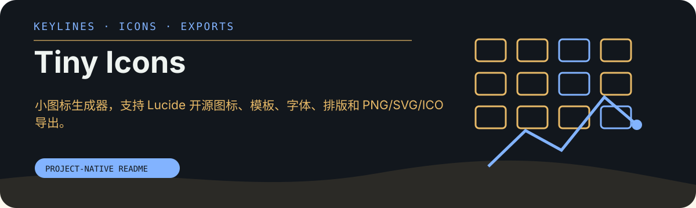
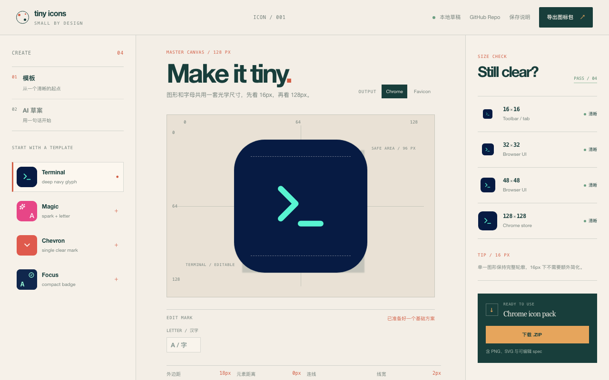

<p align="right"><a href="README.md">中文</a></p>

<p align="center">
  
</p>

<p align="center">
  <a href="https://tiny-icons.xiaosang.cc/">▶ Make Icons</a>
  ·
  <a href="https://github.com/holynova/tiny-icons">GitHub Repository</a>
</p>

Tiny Icons is a focused icon maker for Chrome extensions and favicons: start from 46 open-source Lucide icons and 4 templates, tune colors, fonts and layout on a 128px master canvas, pass the 16px clarity check first, then export the full icon pack in one click. Everything is generated locally; no account needed.

## Screenshot

<p align="center">
  
</p>

## Features

- **46 Lucide icons**: open-source icons — terminal, rocket, shield, eye, star and more — with glyphs and letters sharing one optical sizing system.
- **4 templates**: Terminal (dark-blue terminal), Magic (pink spark + letter), Chevron (red chevron), Focus (compact badge), applied in one click.
- **15 layouts**: top-bottom, left-right, centered, corners, staggered corners, diamond four-point, cross four-point and more; glyph and letter slots are editable separately.
- **4 fonts**: Plus Jakarta, Space Grotesk, IBM Plex Sans, IBM Plex Mono; letters support CJK characters.
- **20 color pairings**: preset combinations like dark blue and warm apricot, with freely mixable background and foreground.
- **AI draft**: type one sentence (e.g. "a quiet, reliable developer-tool icon") and get a template matched by local keyword rules — no network call.
- **16px clarity check**: every design is previewed at 16 / 32 / 48 / 128px first; it must stay clear at 16px before export.
- **Local drafts**: designs are stored locally only — no account, no uploads.

## Export

Download the ZIP icon pack in one click; everything is generated in the browser (hand-rolled ZIP and ICO encoding, no third-party libraries):

| Target | Contents |
| :--- | :--- |
| Chrome extension | `icon16.png` / `icon32.png` / `icon48.png` / `icon128.png` + `manifest-snippet.json` + `icon.svg` + `icon-spec.json` |
| Favicon | `icon16.png` / `icon32.png` / `icon48.png` + `favicon.ico` + `icon.svg` + `icon-spec.json` |

## Run Locally

```bash
pnpm install
pnpm dev
```

```bash
pnpm lint
pnpm test      # build + rendered-HTML tests
```

## Tech

- Next.js 16 + React 19 + Tailwind CSS 4; icons from Lucide, fonts from Fontsource (Plus Jakarta / Space Grotesk / IBM Plex).
- Export happens entirely on the client: Canvas-rendered PNGs, a hand-written ICO header, hand-rolled ZIP packing; `icon-spec.json` saves the full design parameters so any icon can be reproduced.
- All logic lives in `app/page.tsx` (about 1,260 lines); `docs/` is the prebuilt GitHub Pages static output.

```
app/page.tsx        All UI and export logic (templates / layouts / fonts / rendering / packing)
app/globals.css     Theme and typography
app/layout.tsx      App shell and font loading
tests/              Rendered-HTML tests
scripts/            GitHub Pages build scripts
docs/               Prebuilt static site (for Pages publishing)
```
