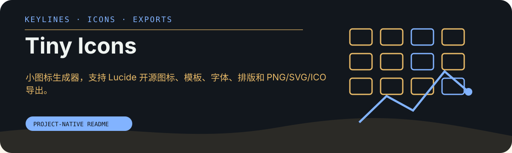
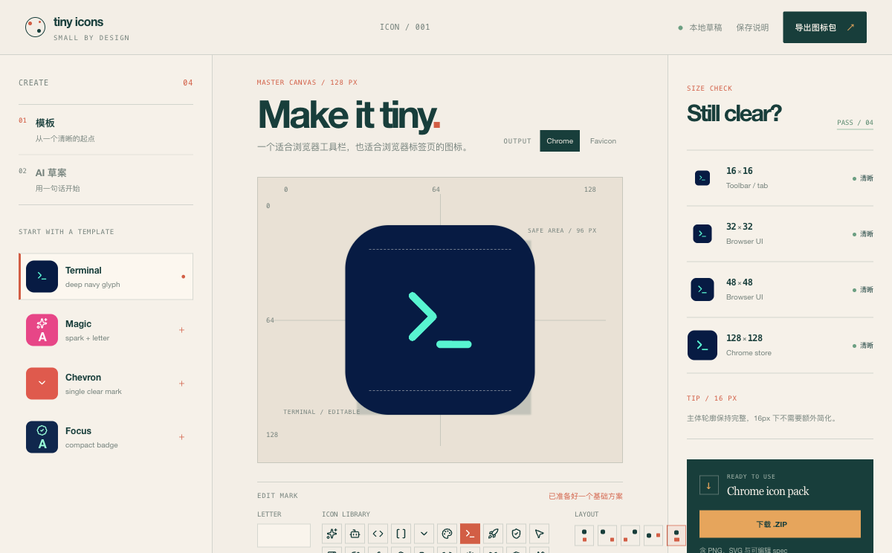

# Tiny Icons

小图标生成器，支持 Lucide 开源图标、模板、字体、排版和 PNG/SVG/ICO 导出。

<p align="center">
  
</p>




[在线制作图标](https://holynova.github.io/tiny-icons/) · [源码](https://github.com/holynova/tiny-icons)

## 做一个图标

选择图标或模板，调整字体与排版，最后按用途导出 PNG、SVG 或 ICO。适合制作扩展图标和网站 favicon。

## 本地开发

需要 Node.js 22.13.0 或更高版本与 pnpm。

```bash
pnpm install --frozen-lockfile
pnpm dev
```

打开终端打印的地址。`pnpm build` 构建应用；`pnpm lint` 检查代码；`pnpm test` 构建并检查渲染结果。
