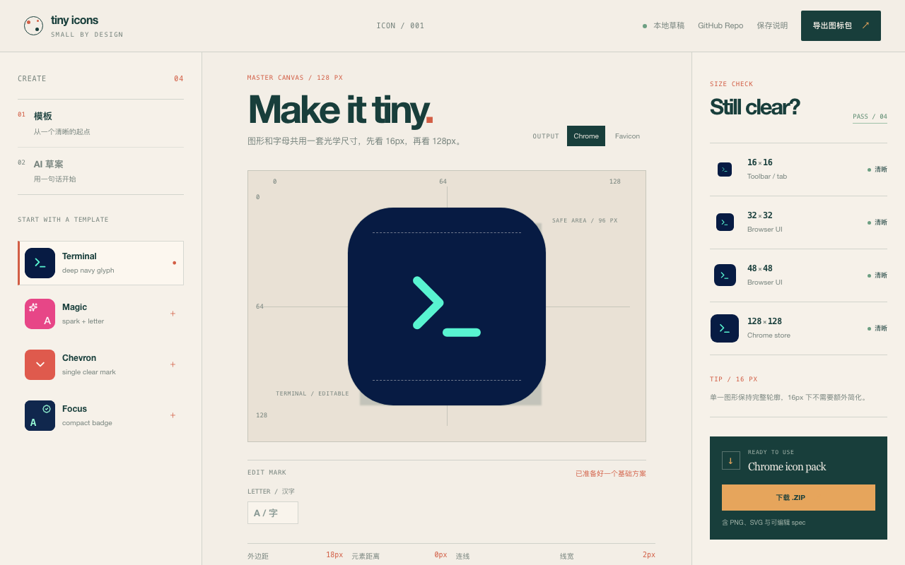

<p align="center">
  
</p>

<p align="center">
  <a href="https://tiny-icons.xiaosang.cc/">▶ 在线制作 Make Icons</a>
  ·
  <a href="https://github.com/holynova/tiny-icons">GitHub 仓库</a>
</p>

Tiny Icons 是一款小图标生成器，专为 Chrome 扩展与网站 Favicon 设计：从 46 个 Lucide 开源图标、4 个模板出发，调配色、字体与排版，在 128px 主画布上编辑，16px 下先过清晰度检查，再一键导出完整图标包。全程本地生成，无需账号。

Tiny Icons is a focused icon maker for Chrome extensions and favicons: start from 46 open-source Lucide icons and 4 templates, tune colors, fonts and layout on a 128px master canvas, pass the 16px clarity check first, then export the full icon pack in one click. Everything is generated locally; no account needed.

## 截图 / Screenshots

<p align="center">
  
</p>

## 功能 / Features

- **46 个 Lucide 图标**：终端、火箭、盾牌、眼睛、星标等开源图标，图形与字母共用一套光学尺寸。
- **4 个模板**：Terminal（深蓝终端）、Magic（粉色火花 + 字母）、Chevron（红色折线）、Focus（紧凑徽章），一键应用。
- **15 种布局**：上下、左右、居中、四角、四角交错、菱形四点、十字四点等；图形与字母可分槽位编辑。
- **4 种字体**：Plus Jakarta、Space Grotesk、IBM Plex Sans、IBM Plex Mono；字母支持汉字。
- **20 种配色**：深蓝、暖杏等预设组合，背景与前景可自由搭配。
- **AI 草案**：输入一句话（如"一个安静、可靠的开发者工具图标"），按关键词匹配模板起稿（本地规则，无需联网）。
- **16px 清晰度检查**：每个方案先过 16 / 32 / 48 / 128 四档预览，16px 下仍清晰才进入导出。
- **本地草稿**：方案只存本地，无账号、无上传。

## 导出 / Export

一键下载 ZIP 图标包，全部在浏览器内生成（手写 ZIP 与 ICO 编码，无第三方库）：

| 目标 | 内容 |
| :--- | :--- |
| Chrome 扩展 | `icon16.png` / `icon32.png` / `icon48.png` / `icon128.png` + `manifest-snippet.json` + `icon.svg` + `icon-spec.json` |
| Favicon | `icon16.png` / `icon32.png` / `icon48.png` + `favicon.ico` + `icon.svg` + `icon-spec.json` |

## 本地运行 / Run Locally

```bash
pnpm install
pnpm dev
```

```bash
pnpm lint
pnpm test      # 构建 + 渲染 HTML 测试
```

## 技术 / Tech

- Next.js 16 + React 19 + Tailwind CSS 4；图标来自 Lucide，字体来自 Fontsource（Plus Jakarta / Space Grotesk / IBM Plex）。
- 导出全在客户端完成：Canvas 渲染 PNG、手写 ICO 文件头、手写 ZIP 打包；`icon-spec.json` 保存完整方案参数，可复现。
- 全部逻辑集中在 `app/page.tsx`（约 1260 行），`docs/` 是预构建的 GitHub Pages 静态产物。

```
app/page.tsx        全部界面与导出逻辑（模板 / 布局 / 字体 / 渲染 / 打包）
app/globals.css     主题与排版
app/layout.tsx      应用外壳与字体加载
tests/              渲染 HTML 测试
scripts/            GitHub Pages 构建脚本
docs/               预构建静态站（Pages 发布用）
```

## English

**Tiny Icons** is a focused icon maker for Chrome extensions and favicons. Start from 46 open-source Lucide icons and 4 templates, tune colors, fonts and layout on a 128px master canvas, and export the full icon pack in one click — generated entirely in the browser, no account, no uploads.

- **46 Lucide icons**, 4 templates (Terminal / Magic / Chevron / Focus), 15 layouts, 4 fonts, 20 color pairings; letters support CJK characters.
- **AI draft**: type one sentence and get a template matched by local keyword rules — no network call.
- **16px clarity check**: every design is previewed at 16 / 32 / 48 / 128px first; it must stay clear at 16px before export.
- **Export**: a ZIP pack — PNGs (Chrome: 16/32/48/128; Favicon: 16/32/48) plus `favicon.ico` (Favicon) or `manifest-snippet.json` (Chrome), `icon.svg` and `icon-spec.json`. ZIP and ICO are encoded by hand-rolled code.
- **Run it**: `pnpm install && pnpm dev`. Tests: `pnpm test` (build + rendered-HTML tests).
- **Tech**: Next.js 16 + React 19 + Tailwind CSS 4, Lucide icons, Fontsource fonts.

## 许可 / License

MIT（见 `package.json`）。
